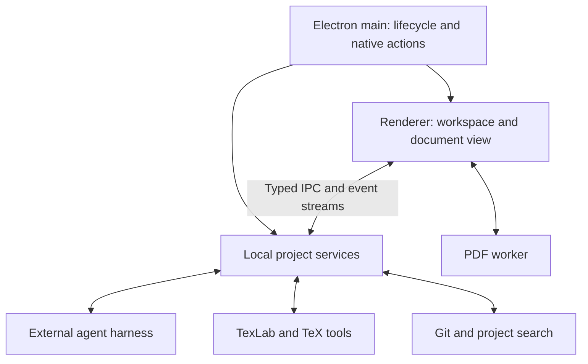

# Loom — Product Requirements Document

**Version:** 1.1

**Date:** 4 November 2026

**Status:** Product requirements baseline. Phases 1–4 are complete for the exercised Linux desktop target; implementation and verification are tracked in [project_status.md](project_status.md). Requirements below continue to describe the full first release, not completed functionality.

**Product:** Free desktop workspace for scientific writing, powered by the researcher's chosen external agent harness.

## 1. Product definition

Loom brings drafting, scientific reasoning, revision, equations, citations, figures, compilation, and preparation for publication into one LaTeX workspace. Researchers work on ordinary research projects and connect an existing agent harness using its supported models and authentication. The agent operates in the context of the manuscript, and its changes appear in the workspace without a manual copy-and-paste cycle.

The first release is an Electron desktop application. Git/GitHub provides asynchronous collaboration and version history. Accounts, cloud synchronization, and live coediting are a subsequent product phase. The initial document architecture must support that evolution.

The interface must closely reproduce the OpenAI Prism workspace shown in the user's supplied screenshot, using Loom's own name and identity. The screenshot establishes the default arrangement; Loom's additional features fit into that arrangement.

### 1.1 Product promise

> Open your paper, connect your agent, and write, revise, compile, and review in one workspace.

The base application is free. Researchers remain responsible for external model/provider charges or subscriptions required by their chosen harness. Free application access does not imply free inference or unlimited future hosted compute.

### 1.2 Decision provenance

The distinction below prevents recommendations from being mistaken for explicit user decisions.

| Topic                      | Planning decision                                                                                | Origin                                                                                                        |
| -------------------------- | ------------------------------------------------------------------------------------------------ | ------------------------------------------------------------------------------------------------------------- |
| Application form           | Electron desktop application                                                                     | Confirmed by user                                                                                             |
| Agent approach             | Integrate existing harnesses; researchers bring their own agent setup                            | Confirmed by user                                                                                             |
| First harnesses            | OpenCode native server/SDK and Codex app-server                                                  | OpenCode initial default; user explicitly requested selectable OpenCode/Codex providers on 4 November 2026    |
| Additional harnesses       | Other supported agents through native protocol adapters                                          | Product direction; staged after the initial OpenCode/Codex integration                                        |
| Live collaboration         | Deferred until after the initial desktop release                                                 | Confirmed by user                                                                                             |
| Accounts                   | No Loom account required for the local release; introduce with cloud services                    | Engineering default; user explicitly deferred live collaboration but did not separately decide account timing |
| Compiler setup             | Detect existing LaTeX installations and guide setup when missing                                 | Confirmed by user                                                                                             |
| Managed LaTeX installation | Later enhancement                                                                                | Confirmed by user                                                                                             |
| Visual reference           | Match the supplied current Prism workspace screenshot                                            | Confirmed by user                                                                                             |
| First validated platform   | Linux x86_64 pilot, matching the current development environment                                 | Engineering default; the user's Codex/OpenCode answer addressed harness choice rather than operating systems  |
| Platform expansion         | Windows and macOS after platform-specific packaging and workflow validation                      | Engineering default; shared implementation must remain portable                                               |
| Core stack                 | Electron, TypeScript, SolidJS, CodeMirror 6, PDF.js, Node.js, TexLab, latexmk, local persistence | Working technical recommendation consolidated from the discussion                                             |
| Shared document foundation | Yjs-backed editing and a versioned bridge to filesystem tools                                    | Working architectural recommendation for future collaboration                                                 |
| Visual prose mode          | Later enhancement; launch uses source editing plus PDF preview                                   | Engineering default; user described visual prose editing as a possible addition                               |

These defaults make the PRD actionable without another clarification round. They may be revised explicitly before the relevant implementation milestone. Desktop launch support must be described according to platforms actually validated.

## 2. Problem and intended users

Researchers move among source editors, PDFs, compilers, reference managers, Git tools, and AI conversations. Context is repeatedly reconstructed, compiler errors interrupt writing, and transferring AI edits back into the manuscript can damage newer edits or disconnect references and comments.

Loom serves researchers and students who already use or need LaTeX: graduate students writing theses, researchers preparing papers, and authors working with technical coauthors. The audience includes researchers across disciplines with little technical experience. The initial workflow assumes access to a desktop computer; tool setup must be guided and must not require understanding compiler terminology to begin writing or previewing a paper.

| User                              | Main job                                       | Success looks like                                                                                              |
| --------------------------------- | ---------------------------------------------- | --------------------------------------------------------------------------------------------------------------- |
| Paper or thesis author            | Draft and revise a substantial manuscript      | Moves between source, evidence, agent edits, and compiled output without transferring text between applications |
| Researcher with a preferred agent | Use an established harness on manuscript files | Keeps the harness's supported model choices and authentication while working in Loom                            |
| Coauthor using Git                | Review and exchange revisions                  | Understands the proposed changes, checks the PDF, and commits/pulls/pushes deliberately                         |
| Researcher learning LaTeX         | Work with a template and resolve errors        | Gets actionable setup and compiler guidance while retaining editable source                                     |

The community research is qualitative evidence, not a representative demand survey. See [the research brief](research/latex-editor-opportunity-brief.md) for firsthand accounts and citations.

## 3. Goals and release boundaries

### 3.1 Goals

1. Make a local LaTeX project usable as a connected manuscript: source, outline, PDF, labels, bibliography, and figures.
2. Integrate a mature external harness rather than implementing a new model/tool execution loop.
3. Support reasoning and revision using relevant project context, with inspectable changes and reliable recovery.
4. Bring literature discovery, citation insertion, and evidence inspection into the writing workflow.
5. Preserve ordinary `.tex`, `.bib`, and asset files for portability and Git collaboration.
6. Keep typing, navigation, and reading responsive during agent activity and compilation.
7. Establish boundaries that allow future accounts and cloud collaboration without replacing the editor core.

### 3.2 First public desktop release

The first release includes project import/open/create, source editing, an outline, local compilation, synchronized PDF navigation, one functioning agent harness, project conversations, direct edits with change review and recovery, literature and bibliography workflows, Zotero access, image-to-LaTeX for supported models, figure/table assistance, Git/GitHub workflows, and source/PDF export.

Internal implementation milestones may introduce these capabilities incrementally. They do not silently remove the research features from the intended first public release.

### 3.3 Later phases

- Loom accounts, shared workspaces, invitations, cloud project storage, live coediting, presence, and anchored collaborator comments.
- Additional agent harness integrations.
- Browser access to shared projects, with a local companion or hosted execution when agent execution is required.
- A managed TeX toolchain and optional isolated cloud compilation.
- Visual prose editing with faithful handling of existing LaTeX.
- Voice editing and transcription; the microphone shown in the reference is not an initial functional requirement.
- Advanced visual table/diagram editors and reproducible analysis pipelines.

### 3.4 Boundaries

- Loom supplies the workspace and integrations; model behavior and execution loops remain the responsibility of the selected harness.
- Scientific reasoning assistance does not establish that a result is correct. Computation requires actual tool execution; empirical claims require evidence or experiments.
- Initial Git collaboration is asynchronous. Shared cursors and simultaneous editing arrive with the cloud phase.
- Arbitrary custom LaTeX may not support every structural feature. Source fidelity, clear diagnostics, and continued raw editing are required.
- Exact app licensing and future hosted-service pricing remain business decisions. No particular open-source license is implied by free access.

## 4. Primary workflows

### 4.1 First project and successful build

1. Launch Loom and open a folder, import a ZIP, clone a repository, or create from a small supported template set.
2. Detect the root document, installed compiler tools, bibliography requirements, and repository status.
3. Explain missing tools and offer platform-appropriate setup guidance; existing source remains accessible.
4. Open the source, file tree, outline, and PDF area in the reference arrangement.
5. Compile and show the output, diagnostics, and build configuration.
6. Close and reopen the application with the manuscript, project configuration, and layout retained.

### 4.2 Connect an agent and revise

1. Detect an installed OpenCode instance or offer setup instructions.
2. Start a Loom-owned local instance or attach explicitly to a compatible existing one.
3. Show available configured models, authentication state, and relevant capabilities.
4. Ask a question or request a change using the manuscript, selection, or attached image as context.
5. Display streamed responses, tool activity, and any harness permission request.
6. Reflect authorized file edits in the editor without losing newer human work.
7. Review the change set, compile, inspect the PDF, and keep or revert the edits.
8. Commit and push only when explicitly requested through the corresponding workflow.

### 4.3 Find and incorporate literature

1. Select a manuscript claim or open citation search.
2. Search arXiv, the project bibliography, or a connected Zotero library.
3. Inspect title, authors, year, identifiers, and available evidence.
4. Choose a source and add a valid bibliography entry and citation.
5. Ask the agent to revise the surrounding discussion using that source.
6. Inspect the proposed interpretation and compile the resulting manuscript.

### 4.4 Convert a whiteboard equation or diagram

1. Attach or paste an image in the agent composer.
2. Verify that the selected harness/model accepts image input.
3. Request conversion using the manuscript's notation and conventions.
4. Inspect editable LaTeX and, for suitable diagrams, a representation such as TikZ.
5. Resolve uncertain handwriting or structure before insertion.
6. Insert into the selected location, compile, and compare against the original image.

### 4.5 Review and exchange a Git revision

1. Open the repository's branch and change view.
2. Inspect changed source and assets alongside the relevant PDF.
3. Select changes to stage, enter a commit message, and commit.
4. Fetch/pull/push with the existing Git authentication setup.
5. If changes conflict, preserve both versions and offer a resolvable review state.

## 5. Functional requirements

Requirement IDs are stable identifiers for implementation and release acceptance. All requirements in this section target the first public desktop release unless explicitly qualified.

### FR-01 — Projects and portable files

- Open existing folders, create a project from supported templates, import ZIP archives, and clone a Git repository.
- Preserve existing source, custom classes, bibliography entries, and assets without converting the project to a proprietary manuscript format.
- Support projects containing multiple source files, subdirectories, images, and local style/class files.
- Detect likely root documents and let the author select one when detection is ambiguous.
- Provide file creation, renaming, move, deletion with recovery where Loom performs the operation, and project-wide text search. New file opens the native location picker, starting inside the current project; reject destinations outside it and preserve existing files.
- Do not change the original project merely to inspect it. Explain when a requested action will create configuration or output files.
- Keep transient build data, agent state, credentials, and machine-specific paths out of default repository exports and commits.

**Acceptance:** A representative existing multi-file project opens, edits, compiles with a compatible local setup, exports, and remains usable in another LaTeX editor.

### FR-02 — Source editor and manuscript structure

- Provide syntax highlighting, line numbers, undo/redo, find/replace, indentation, wrapping, keyboard shortcuts, file tabs, and navigation.
- Project search supports ranked filename abbreviations and small word/phrase typos, with exact matches first and visible match highlighting in results and source. Numbers, very short words and punctuation-heavy expressions retain literal content matching. Find/replace remains precise rather than applying fuzzy replacements.
- Provide an outline of sections and supported structural elements; clicking an item locates its source.
- Connect labels, citations, and figures to their definitions or project resources where the structure is resolvable.
- Use TexLab for supported completion, navigation, and diagnostics rather than recreating its language intelligence.
- Preserve custom macros and source constructs even when Loom cannot interpret them structurally.
- Apply external edits as document changes rather than resetting the whole editor and losing the caret or undo state.

**Acceptance:** The author can navigate and edit a long multi-file document while agent messages and compilation continue without editor freezes or lost selections.

### FR-03 — Toolchain detection and builds

- Detect installed TeX tools, `latexmk`, supported engines, and BibTeX/Biber requirements.
- Provide guided setup when dependencies are missing; manual source editing remains available.
- Default to a plain-language Create PDF / Update PDF workflow. Keep engine, bibliography backend, timing, versions and raw logs in advanced disclosures. An editable built-in sample must be openable without finding a folder.
- Explain failures with a concrete next action. Distinguish a wrong paper folder from a missing project file or package; opening a different folder remains an explicit user action.
- Support pdfLaTeX, XeLaTeX, and LuaLaTeX where installed and compatible with the project.
- Store the selected root, engine, bibliography tool, and build recipe as project configuration; keep machine-specific executable paths separate.
- Record tool versions in build metadata. Recording versions alone must not be described as a fully reproducible environment.
- Support manual compilation, configurable compilation after editing settles, cancellation, and a clean rebuild action.
- Run one scheduled build at a time per project; consolidate edits arriving during a build into the next requested build.
- Show actionable errors with source locations when available and expose the raw log.
- Keep the last successful PDF available during a new build or build failure, clearly marked if outdated.

**Acceptance:** A project requiring Biber builds with the correct sequence, missing dependencies produce useful instructions, and a failed build does not discard the last successful PDF.

### FR-04 — PDF viewing and source navigation

- Provide page navigation, zoom, text selection, download/export, and an expanded PDF view.
- Support source-to-PDF and PDF-to-source navigation through the build's SyncTeX information where available.
- Distinguish the current source revision from the revision represented by the PDF.
- Use the build's corresponding source mapping. Offer an explicit recompile when current source no longer matches the displayed output.
- Preserve reading position after compilation when possible; navigate to a requested edited passage deliberately.
- Virtualize PDF pages and retain a bounded set of rendered canvases.

**Acceptance:** Clicking a resolvable passage navigates to the corresponding source; outdated output is identified and unavailable mappings produce an understandable fallback.

### FR-05 — External harness connection

- The initial selectable harnesses are OpenCode through its native structured local server/SDK and Codex through its app-server protocol. The user expanded Phase 4 to both on 4 November 2026, using T3 Code provider settings as inspiration. Further harnesses use explicit protocol adapters; model execution stays harness-owned.
- Reconnect the paper’s last successfully connected Loom-owned harness after application reopen, preserving its native conversation and model/settings choices. Explicit Disconnect keeps it offline; external server credentials remain transient and attachment remains explicit. Reconnection must never resend a model request.
- Discover installation and configuration state, show setup guidance, and provide connect/disconnect/reconnect actions. Provider settings separate connection status, the native model catalog and optional runtime configuration.
- Run the local agent in the intended project context; show that project identity in the conversation.
- Reuse the harness's supported authentication and configured models. An API key grants model access through the harness; it does not create a new Loom-owned agent runtime.
- Display model-dependent capabilities, including image support, instead of assuming every configuration supports the same features.
- Support session creation, continuation, streamed output, cancellation, questions, permission responses, and recovery after interruption. Put native reasoning and permission choices beside the composer, show only supported distinctions, and retain them per chat. Changing chats must not silently escalate the active chat’s permissions.
- Use a common adapter contract so later harnesses can map their native protocols to the same product concepts. ACP is an option where supported, not a requirement that every harness must implement it.
- Bind Loom-owned agent services to a private local endpoint with suitable authentication. Stop processes Loom owns when appropriate; do not terminate unrelated user-owned instances.
- Establish a supported harness version range and report incompatible versions clearly.

**Acceptance:** A researcher connects a configured harness, selects an available model, sends a project-aware request, answers a permission prompt, cancels a request, and resumes a conversation after reconnecting.

### FR-06 — Scientific reasoning and contextual conversations

- Support discussion of ideas, assumptions, hypotheses, arguments, derivations, and manuscript organization.
- Give the agent access to relevant source files, bibliography, figures, build output, and explicit author instructions through the harness and Loom tools.
- Project-wide context means relevant content can be accessed and traced across files. It does not promise that every project byte is sent in every request.
- Allow users to attach selected text, files, and supported images and inspect which explicit attachments accompany a request.
- Keep project conversations discoverable through the Chats area, with retained session identity and continuation. An idle conversation can switch between connected OpenCode and Codex agents, retaining separate native sessions and permissions with shared public context. Offer explicit conversation deletion with confirmation; preserve manuscript files, change recovery and harness-owned history.
- Keep submitted file cards and each image preview attached to their originating author message across conversation refresh, switching and application restart. The preview must use the protected submitted copy, so later edits to the project asset cannot silently change what the author sent.
- Label unavailable capabilities and interrupted work clearly. Preserve messages and author input across recoverable failures.
- Distinguish an unexecuted suggestion from an actual computation or tool result. Do not report an experiment or verification as performed without evidence.

**Acceptance:** An author asks where an assumption enters a derivation; the agent can inspect the relevant files and return locations and explanations that the author can inspect.

### FR-07 — Direct edits, change review, and recovery

- Capture a recoverable baseline and source revisions before an agent turn that may edit files.
- Reflect authorized edits directly in the workspace and group them by agent turn and affected file.
- Show meaningful before/after diffs, support review, and provide safe revert actions.
- Preserve newer user edits. A revert or incoming agent patch must detect changed source and offer resolution rather than overwrite it silently.
- Surface native harness permission requests. Loom must not silently approve every request or claim a stronger execution boundary than the integrated harness provides.
- Initial editing semantics are **direct writes with review and recovery**. Review after a write must not be presented as pre-execution approval. A future proposal-only mode may stage all edits before application.
- Keep agent edits, compilation, Git commits, and remote pushes as distinct operations with clear status.
- Recover partially completed multi-file changes after cancellation or failure; list affected files instead of reporting false success.

**Acceptance:** An agent revision appears without manual transfer, can be compared with its baseline, and can be reverted without discarding text the author added afterward.

### FR-08 — Literature search and evidence inspection

- Search arXiv and local bibliography records from queries or manuscript context.
- Show titles, authors, publication dates where available, identifiers, and direct source links.
- Make the available evidence level explicit: bibliographic record, abstract, accessible full text, or inspected excerpt.
- When suggesting a paper for a claim, show the available supporting material and allow the author to open the source. A search result's existence is not proof it supports the claim.
- Preserve traceability when the agent revises the manuscript using newly selected related work.
- Handle unavailable sources, rate limits, network failures, and partial search results without fabricating metadata or papers.

**Acceptance:** An author can inspect a real retrieved record, choose it, and trace an inserted citation and related text back to its source.

### FR-09 — Bibliography and Zotero

- Parse and search project `.bib` records by author, title, year, DOI, and citation key.
- Connect a researcher's Zotero library through a supported read-oriented integration; select records to import into the project bibliography.
- Limit initial Zotero behavior to reading/searching and explicit import; bidirectional library mutation is a later capability.
- Search by a manuscript claim through the literature/agent workflow, returning inspectable candidates rather than claiming keyword search proves semantic support.
- Preview bibliographic metadata and citation keys before insertion; handle duplicate records and key collisions explicitly.
- Insert the entry and the citation together and preserve the project's selected bibliography conventions.
- Flag missing keys, duplicate identifiers/keys, incomplete entries, and unused bibliography records. Treat unused entries as informational rather than necessarily erroneous.
- Preserve unknown BibTeX fields and do not silently rewrite an entire bibliography.

**Acceptance:** A selected Zotero or retrieved paper becomes a valid editable bibliography entry and citation; a repeated import does not silently create a duplicate or overwrite a different record.

### FR-10 — Equations, figures, tables, and image conversion

- Create and revise equations, table source, figure environments, captions, and labels in manuscript context.
- Support consistent notation changes across selected or project-wide locations with inspectable diffs.
- Convert whiteboard/handwritten equations and suitable diagrams using a connected image-capable model.
- Provide editable LaTeX and, where suitable, editable TikZ; show uncertain interpretation and allow correction.
- Preserve source images and existing assets unless the author explicitly requests replacement.
- When adding an asset, use a project-relative location, include appropriate references, and check relevant labels and paths.
- Show the compiled result and its build status; compiling successfully does not prove mathematical equivalence.
- Allow a capable harness to run requested local computations under its permission model; show the actual inputs/results used. A general notebook environment is outside the initial scope.

**Acceptance:** A supported image converts into editable source, can be inserted and compiled, and can be compared with the original. Unsupported models show a model-switch/setup path rather than a nonfunctional control.

### FR-11 — Git and GitHub collaboration

- Detect repositories, show the active branch, and list changed/staged/untracked files.
- Provide source diff review, selective staging, commits, fetch, pull, push, clone, and branch selection/creation.
- Use existing Git credentials or guided setup. Loom account identity and Git host identity are separate concerns.
- Warn about a dirty working state before a branch switch or incoming operation that could overwrite work; provide a recoverable route.
- Import pulled changes into the active document model using the filesystem bridge.
- Surface merge conflicts and preserve both inputs until resolved.
- Never automatically force-push or publish a revision as a side effect of an agent editing request.
- Pull request creation and richer GitHub review integration are optional follow-up capabilities; basic GitHub-backed repository exchange is required.

**Acceptance:** Two authors using separate clones can exchange manuscript revisions through normal commits and pulls, and conflicting changes are surfaced without silent loss.

### FR-12 — Publication preparation and export

- Export the latest successfully compiled PDF and a portable source ZIP.
- Make it clear when the exported PDF represents an older source revision.
- Include required project assets and local class/style files; exclude credentials, private session data, and transient caches by default.
- Provide a preflight summary of build failures, unresolved citations/labels, missing assets, and known configuration issues.
- Let the agent help adapt to supplied journal or conference instructions using editable project changes.
- Do not claim universal publisher acceptance or lossless conversion to Word. Complex submissions still require author review.

**Acceptance:** An exported source archive can be extracted and compiled with an appropriately compatible documented toolchain.

### FR-13 — Preferences and application state

- Persist project selection, open files, panel arrangement, editor preferences, build configuration, and agent session references.
- Support the supplied dark Prism reference as the first visual acceptance baseline; light/system themes may follow through the same token system.
- Provide accessible keyboard navigation, focus states, tooltips, and adjustable editor font/wrapping.
- Keep credential storage, project settings, UI preferences, and source content in separate documented locations.
- Make unavailable later-phase actions discoverable only with honest explanatory behavior; do not ship inert controls that imply working sharing, voice, or collaboration.

**Acceptance:** Reopening a project restores useful working state and no visible control falsely implies a working cloud or voice capability.

## 6. UI and layout requirements

The user's [Prism screenshot](design/references/prism-workspace.png) is the primary visual reference. [DESIGN.md](DESIGN.md) records the design intent and observed structure.

The official Loom identity uses the author-selected branching symbol and a Loom wordmark; show it consistently in library/workspace identity headers and application icons. Keep product mentions in explanatory text readable as text. Brand assets and usage are governed by DESIGN.md.

### 6.1 Default workspace

| Region             | Required structure                                                                                                                        |
| ------------------ | ----------------------------------------------------------------------------------------------------------------------------------------- |
| Left sidebar       | Loom identity, collapse control, project selector, Files/Chats tabs, search/add actions, file tree, outline, local workspace/profile area |
| Center             | Open file tabs, Tools action, source editor with line numbers, assistant composer anchored at the bottom of this column                   |
| Assistant composer | Prompt entry, attachments, harness/model controls, send/stop state; capability-aware actions                                              |
| Right              | Light PDF surface, build state and controls, expand/export/overflow actions, rendered paper, navigation                                   |

The screenshot's approximate width allocation is 30% sidebar, 42% editor/composer, and 27% PDF, plus insets. Use those proportions for comparison at the reference size, with resizable/collapsible behavior at other window sizes. The composer does not span the entire application width.

### 6.2 Loom additions

- Put harness selection and connection state near model selection in the composer.
- Make Git state and change review reachable without permanently displacing the manuscript.
- Open citation, literature, diagnostics, and change-review surfaces contextually.
- Keep local save state, build state, agent state, and eventual cloud synchronization separate.
- Preserve panel geometry during loading/errors; long content scrolls within the relevant surface.
- Support focus modes for smaller windows and keyboard alternatives to resizing.

The supplied screenshot does not establish expanded chat placement, Tools contents, settings, or menus. Those screens must follow the same visual language and be reviewed as Loom design decisions rather than described as exact observed Prism behavior.

## 7. Technical architecture

### 7.1 Desktop stack

| Concern                | Working choice                                                                             | Responsibility                                                  |
| ---------------------- | ------------------------------------------------------------------------------------------ | --------------------------------------------------------------- |
| Shell and build        | Electron, TypeScript, electron-vite                                                        | Desktop lifecycle, packaging inputs, typed boundaries           |
| UI                     | SolidJS                                                                                    | Workspace controls and targeted state updates                   |
| Source editing         | CodeMirror 6                                                                               | Editing transactions, selections, decorations, undo integration |
| Shared text            | Yjs with the CodeMirror 6 binding                                                          | Live text model designed for future synchronized editing        |
| PDF                    | PDF.js with its worker                                                                     | Rendering, selection, bounded page caching                      |
| Local services         | Node.js in an Electron utility process                                                     | Filesystem reconciliation, agent adapters, builds, Git          |
| Language features      | TexLab over LSP                                                                            | LaTeX language intelligence                                     |
| Builds                 | latexmk and installed TeX engines/BibTeX/Biber                                             | Compatible native compilation                                   |
| Local persistence      | IndexedDB for Yjs; SQLite for app metadata and derived indexes                             | Durable local work and application state                        |
| Search/version control | ripgrep and native Git                                                                     | Source search and asynchronous collaboration                    |
| Harness                | OpenCode local server/TypeScript SDK first                                                 | Existing agent execution and supported provider access          |
| Agent tools            | Loom tools exposed through supported integration surfaces, including MCP where appropriate | Compilation, project diagnostics, literature workflows          |
| Distribution           | electron-builder                                                                           | Platform-specific application packages and updates              |

Use a shared contract layer for typed commands/events and validation at process boundaries. Keep application identity and document services independent of SolidJS and Electron so a later browser interface can reuse them.

No additional custom Rust application backend is required initially. Profile Loom-owned work before introducing native extensions beyond existing tools.

### 7.2 Process boundaries

Keep expensive computation and blocking I/O away from the renderer and Electron main process. Batch high-frequency agent events and run heavy parsing/diffs/indexing in suitable workers. Use an internal transport abstraction; do not require an HTTP cloud request for local keystrokes.

## 8. Document ownership and data integrity

### 8.1 One live text model

Yjs-backed documents own live text while a project is open. CodeMirror edits that model. The filesystem contains ordinary source files synchronized with it for compilers, Git, external editors, and harnesses.

The filesystem and live model must not behave as independent authorities. The bridge maintains baseline content/revisions, identifies its own writes to avoid feedback loops, and reconciles external changes against the last synchronized state.

- Import existing source on first open and compare durable local state against disk when reopening.
- Serialize saves and external patch application so later writes cannot silently replace newer work.
- Retain stable file IDs independently of paths; renames update the project manifest.
- Provide explicit behavior for file deletion, move, binary replacement, and branch changes.
- Make recovery independent of whether the author has committed to Git.
- Test local persistence and export before introducing network synchronization.

### 8.2 Source and PDF version relationship

Each build records a source snapshot identifier, root file, tool configuration, start/end state, diagnostics, and output paths. Build from a stable snapshot or detect changing inputs and label the result accordingly. PDF navigation uses the matching build's mapping data.

### 8.3 Core product records

| Record              | Essential information                                                                           |
| ------------------- | ----------------------------------------------------------------------------------------------- |
| Project             | Stable ID, local root, name, root document, file manifest, portable build settings              |
| Project file        | Stable ID, relative path, content type, live/disk revision, persistence state                   |
| Agent session       | Project ID, harness ID, harness session ID, model/capabilities, conversation references, state  |
| Change set          | Baseline and resulting revisions, affected files, agent turn, review/recovery information       |
| Build               | Source snapshot, tool versions/configuration, status, log/diagnostics, PDF and mapping metadata |
| Bibliography record | Key, metadata, identifiers, origin, source/evidence links, duplicate status                     |
| Research attachment | Local asset identity, provenance, explicit agent-use context                                    |
| Git state           | Repository, branch, index/worktree status, operation state; native Git remains authoritative    |

Store recoverable source separately from disposable indexes. Bound logs, caches, and retained snapshots with a documented retention policy. Checkpoints must remain available until an operation no longer depends on them.

## 9. Future accounts and cloud collaboration

This section defines compatibility requirements, not services that must be deployed for the local release.

- Add a Node.js/Fastify API for accounts, project membership, roles, and project administration.
- Use managed identity with native-app browser login and PKCE; keep Loom identity separate from harness/provider and Git identities.
- Use a Yjs-compatible collaboration service such as Hocuspocus with server-enforced project access, durable persistence, and explicit local/cloud save acknowledgments.
- Use PostgreSQL for memberships, permissions, metadata, and durable collaboration records; use object storage for binary assets, snapshots, and build artifacts.
- Add queued, isolated cloud build workers independently of the collaboration service.
- Scale API requests, document synchronization, and expensive jobs separately. Start with simple deployments and add coordination/sharding when workload evidence requires it.
- Establish owner/editor/commenter/viewer roles before enabling shared access. Enforce permission changes on active connections as well as API requests.
- Keep agent credentials local by default. Sharing a project does not automatically share a conversation, research attachment, or agent access.
- Use anchored comments and per-user undo semantics in collaborative documents. CRDT text merging does not resolve scientific disagreement or guarantee a project-level multi-file transaction.
- Preserve the document/file bridge and revision checks when remote updates, Git operations, and agent edits occur together.
- Define sharing, storage, retention, and hosted-compute allowances before public cloud availability.

## 10. Quality and performance requirements

### 10.1 Responsiveness

Performance figures below are proposed engineering targets, not measured results. Establish a baseline on a documented Linux pilot machine with at least four CPU cores, 16 GB RAM, SSD storage, and a 1080p display. Report packaged-release measurements; external model/network latency and native compiler duration are measured separately.

| Workload                                       | Initial target                                                                                                      |
| ---------------------------------------------- | ------------------------------------------------------------------------------------------------------------------- |
| Typing during a build and agent stream         | p95 input-to-paint below 50 ms; no recurring long UI stalls                                                         |
| Cold launch into a recent local project        | Usable editor within 3 seconds on the reference machine, with optional services loading afterward                   |
| Open an indexed source file up to 10,000 lines | p95 below 250 ms after project initialization                                                                       |
| Navigate using an available source/PDF mapping | p95 below 250 ms once the relevant source and PDF are loaded                                                        |
| Local indexed bibliography search              | p95 below 200 ms for 5,000 entries                                                                                  |
| Automatic save                                 | Normally begins after a short idle interval; explicit Save flushes pending work and acknowledges actual persistence |
| Idle workspace                                 | No polling/rebuild loops; app-owned CPU returns close to idle after background work settles                         |

Use a larger test project containing at least 100,000 lines across 1,000 files, a 200-page PDF, and 5,000 bibliography entries. Track memory over repeated edits/builds and verify bounded caches rather than assuming a fixed memory figure proves efficiency.

### 10.2 Reliability and compatibility

- Maintain recoverable local work after a renderer crash or interrupted agent operation.
- Keep undo, source snapshots, and Git history conceptually distinct.
- Support Unicode/IME input, paths containing spaces and non-ASCII characters, and multi-file projects.
- Surface unsupported tools, models, packages, and platform features with an actionable message.
- Keep local editing and installed-tool compilation usable without a network connection; literature search and remote models may require connectivity.
- Target WCAG 2.2 AA for application controls, including keyboard access, focus, labels, contrast, and reduced motion.
- Preserve normal LaTeX output fidelity; Loom UI styling must not change the manuscript's typesetting.

### 10.3 Credential and execution handling

- Keep Electron renderer privileges narrow and route native actions through explicit interfaces.
- Protect local agent endpoints and do not expose project execution publicly by default.
- Use the harness's supported credential flow and protected credential storage where Loom stores a secret.
- Keep credentials out of project files, Git, exports, screenshots generated for diagnostics, and application logs.
- Explain when manuscript content or attachments are sent to a selected model/provider or literature service. Local project storage does not imply all AI processing is local.
- Preserve harness permission requests and document what the integration can actually enforce. A project path setting alone is not a sandbox for arbitrary shell execution.
- Treat a TeX project's custom commands and shell-escape requirements as execution configuration that the author controls; imported projects must not silently enable broader command execution.

## 11. Success measures

| Outcome                                | Measurement                                                                                                |
| -------------------------------------- | ---------------------------------------------------------------------------------------------------------- |
| Researcher reaches a useful workspace  | Completion rate for opening a real project, configuring tools, and producing the first successful PDF      |
| AI integration saves transfer work     | Author completes a revision and sees it in the source/PDF without copying text through another application |
| Changes remain trustworthy             | Accepted/reverted change sets, manual repairs, stale-edit incidents, and recoverable failures              |
| Citation workflow is useful            | Time to a verified citation; missing/incorrect metadata and duplicate insertion rates                      |
| Workspace is responsive                | Recorded startup, typing, navigation, memory-growth, and build-concurrency measurements                    |
| Product becomes a regular writing tool | Voluntary pilot feedback and repeated use over a two-week writing period                                   |

Begin with opt-in pilot feedback and local diagnostics. Any remote analytics must be explicit and exclude manuscript content and credentials by default. Do not invent adoption statistics before testing with researchers.

## 12. Implementation milestones and release acceptance

Milestones are dependency ordered rather than calendar estimates.

| Milestone                    | Deliverable                                                                                              | Exit condition                                                                                                                         |
| ---------------------------- | -------------------------------------------------------------------------------------------------------- | -------------------------------------------------------------------------------------------------------------------------------------- |
| M1 — Workspace foundation    | Electron shell, shared types, Prism-reference layout, project files, CodeMirror, Yjs persistence         | A real source project opens, edits, saves, and reopens without lost text; screenshot comparison at reference and smaller desktop sizes |
| M2 — Complete LaTeX loop     | Tool detection, TexLab, build scheduler, PDF.js, diagnostics, SyncTeX                                    | Compatible multi-file projects build; stale PDF and missing dependency cases behave correctly                                          |
| M3 — External agent workflow | OpenCode adapter, sessions, composer, permission UI, file reconciliation, change review/recovery         | A project-aware revision is applied, compiled, inspected, cancelled/resumed, and safely reverted                                       |
| M4 — Research features       | arXiv search, bibliography validation, Zotero import, image conversion, equation/figure/table assistance | Verified sources and supported image inputs produce inspectable, portable manuscript edits                                             |
| M5 — Git and publication     | Repository operations, conflict handling, source/PDF export, preflight                                   | Two clones exchange revisions; source archive builds with a documented compatible toolchain                                            |
| M6 — Pilot release           | Packaged Linux build, onboarding, recovery, performance and compatibility checks                         | Release acceptance suite passes with recorded limitations and no unresolved source-loss defects                                        |
| M7 — Expansion               | Additional platforms/harnesses, followed by accounts and cloud collaboration                             | Each capability passes its own packaging, permission, persistence, and end-to-end workflow checks                                      |

### First-release acceptance scenarios

1. Import a multi-file paper and compile it using detected local tools.
2. Open a project with missing LaTeX dependencies and complete the guided path to a successful build.
3. Navigate between source, outline, labels/citations, and the corresponding compiled PDF locations.
4. Ask the connected agent to inspect an argument across files and make a focused revision.
5. Edit overlapping source while the agent is working; verify Loom preserves the newer change or presents a resolution.
6. Cancel a multi-file agent operation and recover a coherent inspectable state.
7. Retrieve literature, inspect available evidence, insert a citation, and avoid a duplicate on repeated import.
8. Search and import a Zotero record without unexpectedly mutating the user's library.
9. Convert a supported image to editable LaTeX and identify a model that cannot accept image input.
10. Exchange changes through Git and resolve a conflict without source loss.
11. Export source/PDF while clearly identifying an outdated PDF.
12. Restart after an interrupted operation and recover local work.
13. Run the large-project workload while compiling and streaming agent output; record responsiveness and resource behavior.
14. Confirm project exports and default Git operations exclude credentials, private chats, and disposable caches.

## 13. Principal risks and product responses

| Risk                                           | Product response                                                                                                    |
| ---------------------------------------------- | ------------------------------------------------------------------------------------------------------------------- |
| Harness version or protocol changes            | Supported version ranges, adapter isolation, compatibility checks, recorded integration fixtures                    |
| Agent file writes conflict with live state     | Versioned filesystem bridge, baselines, grouped changes, conflict detection, safe revert                            |
| Compiler setup remains difficult               | Detection, understandable dependency diagnostics, guided setup; managed installs later                              |
| Scientific or citation suggestions are wrong   | Inspectable evidence, explicit uncertainty, source links, author review, actual build/tool results                  |
| Custom LaTeX exceeds parser understanding      | Preserve source and allow manual control; degrade structural assistance explicitly                                  |
| Large PDFs or event streams consume resources  | Bounded rendering/caches, virtualization, batched events, separate workers, measured workloads                      |
| UI fidelity obscures unavailable functionality | Match the reference while making deferred features honestly unavailable or replacing them with useful local actions |
| Later collaboration requires a rewrite         | Shared document model and stable IDs now; deferred cloud deployment with defined service boundaries                 |

## 14. References and related artifacts

- [Loom design direction](DESIGN.md).
- [User-supplied Prism workspace screenshot](design/references/prism-workspace.png), supplied 3 November 2026. This is a layout reference, not a redistribution asset for Loom's marketing.
- [Qualitative researcher/student research](research/latex-editor-opportunity-brief.md).
- [OpenCode server](https://opencode.ai/docs/server/) and [TypeScript SDK](https://opencode.ai/docs/sdk/): structured local integration surfaces supporting the first-harness choice. The simplicity judgment is an engineering inference.
- [OpenCode permission model](https://opencode.ai/docs/permissions/): permission behavior remains harness-owned and must be surfaced faithfully.
- [Yjs](https://docs.yjs.dev/), [CodeMirror 6 binding](https://github.com/yjs/y-codemirror.next), and [local persistence adapter](https://github.com/yjs/y-indexeddb).
- [CodeMirror system guide](https://codemirror.net/docs/guide/) and [PDF.js](https://mozilla.github.io/pdf.js/getting_started/).
- [Electron performance guide](https://www.electronjs.org/docs/latest/tutorial/performance) and [utility process API](https://www.electronjs.org/docs/latest/api/utility-process).
- [TexLab](https://github.com/latex-lsp/texlab) and [latexmk](https://ctan.org/pkg/latexmk).
- [Hocuspocus collaboration service](https://tiptap.dev/docs/hocuspocus/getting-started/overview) and [scaling guidance](https://tiptap.dev/docs/hocuspocus/guides/scalability), for the future cloud phase.
- [Native application OAuth guidance](https://www.rfc-editor.org/rfc/rfc8252), for future account integration.

This PRD supersedes earlier conversational assumptions where they differ from the explicit user decisions recorded in Section 1.2. It does not turn every idea from the research brief into a launch requirement; release scope is defined in Sections 3–5.

### Manual beta interaction refinements (5 November 2026)

- A completed agent source edit opens its changed passage in the matching successful PDF using source mapping. Preserve current writing and report unavailable mapping/builds instead of guessing a page or displaying stale output as current.
- Authors can ask the connected agent to save editor work, create/delete/move ordinary project files into folders, and inspect or assign the main LaTeX document. Keep recovery and native permissions intact; manuscript operations do not authorize Git commits or pushes.
- Appearance is reachable beside Settings, persists on this device, and supports system/light/dark schemes, paired color palettes, contrast, surface opacity, diff colors and message width. Settings, connections and appearance have distinct recognizable icons. Structural panels/dividers use unobtrusive focus cues without white frames; chat drag/hide controls avoid background pills.

### Local project entry — user decision, 5 November 2026

The desktop opens to a local project manager before entering the manuscript workspace. Authors can find and reopen previously registered folders, create projects, or open/import existing LaTeX work. Provide search and list/grid views following the supplied Prism project-library references. Returning from the workspace must preserve pending document work and save working-state preferences. Reopening restores the project's existing documents/recovery, chats, settings and native session references, with device appearance applied to both screens. Keep unavailable folders visible with actionable errors and retained recovery data. No account or authentication is required; shared/cloud project ownership is deferred.
