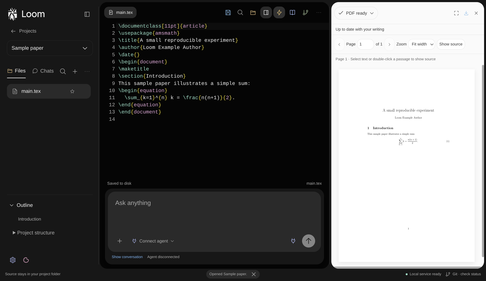

<p align="center">
  <picture>
    <source media="(prefers-color-scheme: dark)" srcset="design/brand/loom-logo-white.svg">
    
  </picture>
</p>

<p align="center"><strong>A local workspace for writing scientific papers with LaTeX and AI assistance.</strong></p>



Loom brings your source, PDF preview, references, and an optional coding agent into one desktop workspace. Your paper stays in an ordinary folder of `.tex`, `.bib`, and asset files, so you can use it with other editors and version-control tools.

Loom is in early development. The current desktop build and packaging have been exercised on Linux x86_64; other platforms have not yet been validated.

## What you can do

- Edit a multi-file LaTeX project and build a PDF locally with `latexmk`. Navigate between source and PDF with SyncTeX.
- Connect an installed OpenCode or Codex agent to ask questions, work on your paper, and inspect changes. Loom can pass relevant build diagnostics and source context when you ask for help with an error.
- Search your local bibliography, arXiv, and an enabled local Zotero library; insert citations into your paper.
- Review changes, use native Git for staging and commits, and export a portable source archive.
- Open an existing folder, create a project, or try the included sample paper.

Agents operate according to the permissions you select in their native harness and can write to project files directly. Review their changes and output. Model availability, authentication, and any remote processing depend on the agent and provider you choose.

## Get started

### Requirements

- Linux x86_64 is the currently exercised target.
- Node.js `^22.12.0`, `^24.0.0`, or `>=26.0.0`, with npm 11 or newer. This repository pins npm 11.19.0; CI is configured for Node.js 26.7.0 and npm 11.19.0.
- Git for cloning and for Loom's Git features.
- A local LaTeX installation with `latexmk` and a supported engine (`pdflatex`, `xelatex`, or `lualatex`) for PDF builds. SyncTeX, BibTeX/Biber, and TexLab enable their respective navigation, bibliography, and language features.
- OpenCode or Codex is optional. Install and authenticate the harness separately, then connect it through **Agent connections**. The current integrations support OpenCode 1.19.x or 2.2.x from 2.2.1, and Codex 0.159.x.

### Run from source

```sh
git clone https://github.com/monabji/loom.git
cd loom
npm ci
npm run dev
```

The development server uses `127.0.0.1:5173`. If that port is already in use, free it or change the renderer port in `electron.vite.config.ts`.

Choose **Create project**, **Open folder**, or **Try a sample paper**. To use PDF features, install the LaTeX tools above or, on Linux x86_64, run:

```sh
npm run setup:latex
```

The setup script downloads a user-local TinyTeX distribution and TexLab under your home directory. It preserves existing installations; review [the script](scripts/setup-latex.mjs) before running it if you prefer to manage tools yourself.

## Development

```sh
npm run check       # formatting, type checking, unit tests, and production build
npm run test:e2e    # Electron tests; build first and use a graphical Linux session
npm run package     # build an unpacked Linux application in release/linux-unpacked/
```

For the desktop tests, run `npm run build` before `npm run test:e2e`. Tests requiring a real TeX installation or authenticated external provider are opt-in and skipped by default. See [CONTRIBUTING.md](CONTRIBUTING.md) for setup, test options, and pull-request guidance.

| Path                          | What lives there                                                       |
| ----------------------------- | ---------------------------------------------------------------------- |
| `src/main`, `src/preload`     | Electron lifecycle and the renderer bridge                             |
| `src/renderer`                | Workspace, editor, PDF, agent, and project UI                          |
| `src/services`                | Project storage, builds, agent integration, Git, and research services |
| `src/contracts`, `src/domain` | Validated contracts and shared domain logic                            |
| `examples`                    | Synthetic LaTeX projects and fixtures                                  |
| `tests`                       | Unit, integration, and Electron tests                                  |
| `design/brand`                | Loom logo, icons, and font attribution                                 |

## Contributing

Issues, documentation improvements, bug fixes, and pull requests are welcome. Start with [CONTRIBUTING.md](CONTRIBUTING.md), and please follow our [Code of Conduct](CODE_OF_CONDUCT.md). For vulnerabilities, use the guidance in [SECURITY.md](SECURITY.md) instead of posting sensitive details publicly.

## License

Loom's source code is available under the [MIT License](LICENSE). Third-party assets may have separate terms; see the [brand assets](design/brand/README.md), [bundled font license](design/brand/fonts/OFL.txt), and [provider mark attribution](src/renderer/ui/provider-assets/README.md).
