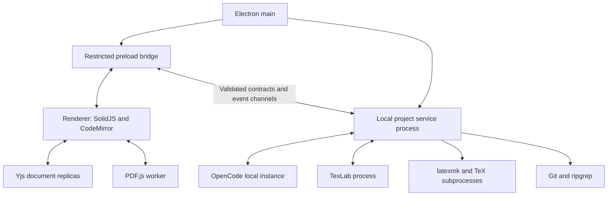

# Loom architecture

**Status:** Phases 1–7 shell, project/document, local build/language, PDF, agent, research, Git and source export services implemented. Verification state and limits belong in project_status.md.

**Product authority:** [PRD.md](PRD.md). **Visual authority:** [DESIGN.md](DESIGN.md). **Build sequence:** [phases.md](phases.md). **Actual implementation state:** [project_status.md](project_status.md).

## 1. System boundaries

Loom supplies a local scientific writing workspace and integrates an external agent harness. It owns manuscript editing, local state, source/PDF navigation, compilation coordination, reference workflows, change review, and Git controls. OpenCode initially owns the model/tool execution loop and its provider configuration. Ordinary project files remain usable outside Loom.

The first validated target is a Linux x86_64 pilot. Process contracts and application services remain portable for later Windows/macOS builds and a future browser client. Accounts, network document synchronization, hosted execution, and live collaboration are outside this build.

## 2. Stack and responsibilities

| Layer                  | Working choice                                 | Ownership                                                                         |
| ---------------------- | ---------------------------------------------- | --------------------------------------------------------------------------------- |
| Desktop shell          | Electron                                       | Windows, lifecycle, native dialogs, protected native entry points                 |
| Application language   | TypeScript                                     | Shared contracts, adapters, application services                                  |
| Development/build      | electron-vite                                  | Main, preload, renderer, worker bundles                                           |
| UI                     | SolidJS                                        | Workspace controls and presentation state                                         |
| Editing                | CodeMirror 6                                   | Editing transactions, selections, decorations, editor integration                 |
| Live text              | Yjs and CodeMirror binding                     | One logical document state, ready for later network providers                     |
| PDF                    | PDF.js and its worker                          | PDF processing, page rendering, selection and navigation                          |
| Native services        | Node.js in an Electron utility process         | Project services, persistence coordination, agent/build/Git subprocess management |
| LaTeX language service | TexLab over LSP                                | Supported completion, diagnostics and structural navigation                       |
| Compilation            | latexmk and installed TeX engines/BibTeX/Biber | Native project compilation                                                        |
| Persistence            | IndexedDB and SQLite                           | Durable Yjs updates; application metadata, manifests, derived indexes             |
| Search and VCS         | ripgrep and native Git                         | Filesystem search and repository operations                                       |
| Agent                  | OpenCode local server and TypeScript SDK       | Initial harness integration                                                       |
| Packaging              | electron-builder                               | Installable desktop artifact                                                      |

Exact dependencies are pinned in `package.json` and `package-lock.json`; the package manager is npm 11.19.0. Phase 1 uses Electron 45.2.1, electron-vite 6.0.0, SolidJS 1.9.18 and TypeScript 6.0.3. CodeMirror, Yjs, IndexedDB and SQLite are now installed/implemented for Phase 2; PDF.js, TexLab and local compilation are implemented for Phase 3; agent and Git integrations remain later-phase choices.

## 3. Process model



- **Main:** create/manage windows, initialize service connections, handle native application actions. It does not parse a large manuscript or execute database/indexing loops.
- **Preload:** expose named application capabilities through context isolation. The renderer receives neither unrestricted filesystem APIs nor arbitrary process execution.
- **Renderer:** manage layout, immediate editing, active document views, PDF display, and user-visible state. Keep document text out of unrelated global UI state.
- **Project services:** coordinate project manifests, serialized saves, reconciliation, builds, harness sessions, Git, search, and SQLite access.
- **Workers/subprocesses:** perform expensive PDF processing, parsing/diffs/indexing where needed, native tool execution, and agent execution. Profile before adding more processes; each has startup and memory costs.

Use command/result IPC for bounded operations and message channels for document updates, progress, and agent events. The selected harness may use its own local HTTP transport; that does not require the entire desktop backend to become an HTTP server.

## 4. Module layout

The following is the intended full module layout. Phases 1–2 create main, preload, contracts, utility project/persistence services, renderer workspace/UI/editor, and their tests; other directories remain planned. A single application package is sufficient initially.

```text
src/
  main/                     Electron lifecycle and native integration
  preload/                  Narrow renderer bridge
  renderer/
    workspace/              Shell, panels, tabs, navigation
    editor/                 CodeMirror and document bindings
    pdf/                    Viewer, render cache, source navigation
    agent/                  Conversation, composer, permission/change views
    references/             Bibliography, Zotero, literature UI
    ui/                     Shared primitives and runtime theme tokens
  contracts/                Transport messages, IDs, validation, error types
  domain/                   Project/revision/build/change-set concepts
  services/
    project/                Manifest, paths, file operations
    documents/              Yjs coordination, revisions, reconciliation
    persistence/            SQLite metadata and storage adapters
    builds/                 Tool detection, scheduling, logs, snapshots
    language/               TexLab integration
    agents/                 Common harness contract and OpenCode adapter
    research/               Literature providers, evidence, bibliography, Zotero
    git/                    Native Git operations and document coordination
  workers/                  Measured CPU-heavy operations
tests/
  fixtures/                 Synthetic manuscripts and protocol fixtures
  integration/              Filesystem/native-protocol workflows
  e2e/                      Application acceptance scenarios
```

Renderer imports domain types and contracts, not native service implementations. Domain rules do not depend on Electron or SolidJS. Concrete integrations implement service interfaces. This keeps a future browser transport possible without building a cloud platform now.

## 5. Document model and filesystem bridge

### 5.1 Ownership

While open, a project uses Yjs-backed live text. Renderer and service replicas represent the same logical documents, not competing editable stores. CodeMirror transactions update those documents. Files on disk are synchronized source representations required by compilers, Git, external editors, and harnesses.

Use stable project/file IDs independently of names and absolute paths. A manifest tracks file IDs, relative paths, content types, and revision information. File creation, moves, deletions, and binary replacement are project operations; Yjs text alone does not implement them.

### 5.2 Local edit path

1. Apply a CodeMirror/Yjs transaction immediately so typing does not await I/O.
2. Persist Yjs updates through the local persistence provider and transmit incremental updates to project services.
3. Services apply the updates, advance revision metadata, and schedule a serialized disk save.
4. Write atomically where supported and acknowledge the revision actually persisted to disk.
5. Mark the UI as saved only for acknowledged persistence. If recovery storage and disk differ, display their state honestly.

The logical revision must identify content; timestamps and watcher events alone are insufficient. Track baseline text or hashes and state information needed to reconstruct changes.

### 5.3 External change path

1. A watcher or operation result reports that a project file changed.
2. Compare actual content against the last synchronized baseline and known Loom writes; suppress write/observe feedback loops.
3. Derive a patch against that baseline.
4. If newer live edits exist, reconcile compatible edits or create a conflict record preserving all inputs.
5. Apply resolved changes to Yjs, update editor transactions, persist, and acknowledge the new synchronized baseline.

Re-reading and replacing the entire editor value is not the reconciliation strategy. Handle duplicate/coalesced watcher events, atomic rename saves, deletion, rapid writes, and non-ASCII paths.

### 5.4 Reopen and recovery

On opening a project, load the manifest and recoverable live state, compare with disk, and resolve divergence before writing. After service/renderer failure, resynchronize document replicas and pending acknowledgments before resuming saves. Recovery is independent of Git commits.

Undo, agent change-set revert, and Git history have separate owners. Preserve unrelated newer edits when reverting an agent change; if that cannot be done safely, present the conflict instead of silently restoring a full old file.

## 6. Persistence and data ownership

| Data                                                    | Storage/authority                                 | Notes                                                                            |
| ------------------------------------------------------- | ------------------------------------------------- | -------------------------------------------------------------------------------- |
| Manuscript source and assets                            | Ordinary project folder                           | Portable representation used by external tools                                   |
| Live recoverable text                                   | Yjs updates persisted with IndexedDB              | Stable local identity and flush/recovery semantics                               |
| Project manifest, preferences, build/session references | SQLite in application data                        | Device paths and transient state stay outside source exports                     |
| Bibliography content                                    | Project `.bib` files                              | Parsed indexes are derived and rebuildable                                       |
| Agent conversation                                      | Harness session plus Loom presentation references | Choose a documented owner for cached messages; avoid divergent session histories |
| Change baselines/recovery checkpoints                   | Protected application data                        | Keep until review/recovery no longer depends on them                             |
| PDF/log/mapping output                                  | Revision-associated build directory               | Bounded cache; retain last successful build as needed                            |
| Harness/provider credentials                            | Harness-supported protected storage               | Never include in manuscript exports or Git                                       |
| Git history/index/worktree                              | Native Git                                        | Loom displays and coordinates it                                                 |

Persist schema versions and migration state. Define cleanup so it cannot delete required recovery content or active build mappings. Persistent project configuration may be exported deliberately; absolute executables, secrets, private chats, and caches are excluded by default.

## 7. Contracts and operation state

Use stable IDs for projects, files, agent sessions, turns, change sets, builds, and operations. Validate input at process boundaries. Include correlation IDs, project identity, and revision preconditions where mutations depend on existing state.

Application operations use explicit states such as `queued`, `running`, `waiting_for_user`, `succeeded`, `failed`, and `cancelled`. An interrupted process is not a successful operation. UI action availability is derived from capability/operation state, not guessed from a button click.

Document save, agent session, Git operation, and PDF build each have their own state. Their identifiers should make it possible to explain: which source this PDF used, which turn produced this change, and whether a save actually reached disk.

Errors carry a stable category, human-readable explanation, affected project/file/operation, retryability, and technical details suitable for a diagnostic view. Exclude secrets and manuscript content from default logs. Bound event buffers and reject stale results after cancellation or a project switch.

## 8. Agent integration

### 8.1 Adapter contract

The common harness boundary covers:

- Installation/version/configuration detection and connection lifecycle.
- Supported authentication setup and available configured model/capability discovery.
- Session create/load/continue and prompt submission with explicit context/attachments.
- Streamed text, public tool activity, questions, permissions, completion/failure, and cancellation.
- Project binding, interruption recovery, and ownership of launched processes.
- Change tracking/recovery coordination around native filesystem edits.

Normalize capabilities without pretending every harness provides every feature. Use OpenCode's native server/SDK initially. Later adapters may use ACP or another structured native protocol. Terminal UI scraping is not the planned integration method.

### 8.2 OpenCode lifecycle

Prefer a dedicated Loom-owned local instance for a project/session boundary so paths, credentials, permissions, and process ownership are explicit. Attaching to an existing compatible instance is an explicit user action. Use private loopback endpoints with suitable authentication, verify the running version, and distinguish server availability from provider authentication.

Track which processes Loom started. Disconnecting from an externally owned server must not terminate the user's unrelated session. Surface permission requests through the harness; a default working directory is not proof of filesystem isolation.

### 8.3 Edits and tools

Before an editing turn, capture affected project revision/baseline information and a recoverable checkpoint. Observe native agent writes through the document bridge and group changes by turn. Initial semantics are authorized direct edits followed by review/recovery; they are not universally staged before execution.

Expose Loom-specific capabilities through supported tool integration, including MCP where appropriate. Tools may request a scheduled build, inspect diagnostics, query project references, or retrieve literature. Registered compile tools should use Loom's scheduler so output can be associated with its source revision. Arbitrary shell execution remains governed by the harness's actual permissions.

Project context is retrieved through relevant files and tools. The agent can inspect the manuscript's structure and dependencies without sending every file in every request. Preserve provenance and distinguish an explanation from an executed check.

## 9. Builds, language features, and PDF

The toolchain service detects installed `latexmk`, engines, and bibliography tools and records compatible configuration. Guided setup links to suitable installation instructions; the initial app does not bundle a complete managed TeX distribution.

Use one build scheduler per project. Coalesce pending edits, support cancellation and clean rebuilds, and capture a stable source snapshot or identify changed inputs. Do not compete with a second automatic build loop owned by the language integration.

A build record includes source snapshot ID, file/path manifest, root file, engine/recipe/tool versions, diagnostics, timestamps, status, and PDF/mapping locations. Keep snapshot paths mapped to original project paths so SyncTeX can navigate correctly. Record versions without promising a fully reproducible environment.

TexLab receives the document versions needed for language features; native diagnostics and parsed compiler logs remain traceable to files/revisions. A failed build retains the last successful PDF with a stale/failed indication.

PDF.js processes PDFs through its worker. Render visible pages plus a small bounded buffer, cancel obsolete render requests, release distant canvases, and preserve useful reading position. Use the mapping from the displayed build, not an unrelated current build. Report approximate/unavailable source mapping honestly.

## 10. Research and bibliography services

Use provider interfaces for arXiv, Zotero, and local bibliography lookup. Normalize bibliographic identifiers and metadata while preserving original BibTeX fields. Derived indexes can use SQLite full-text search; file content remains authoritative.

Search candidates carry provenance, retrieval state, available evidence level, and direct source links. A record may have metadata/abstract only; the interface must not imply full-text inspection. Citation insertion groups a bibliography update with its source reference and handles duplicate identifiers and key collisions.

Zotero integration initially reads/searches a supported library and imports explicit selections. No general bidirectional library editing is required. Whiteboard conversion and figure/table assistance use supported harness/model capabilities; preserve original assets and allow correction before interpreting results as manuscript content.

## 11. Git and export coordination

Native Git owns repository state and credential use. Loom coordinates operations with live documents:

1. Flush or preserve pending edits and capture a baseline before a mutation that can change working files.
2. Inspect the dirty state and present relevant choices before pull, merge, or branch switching.
3. Serialize incompatible operations with agent editing and saves.
4. Reconcile resulting filesystem changes into the live document model.
5. Surface conflicts and retain the inputs until resolved.

The utility process invokes Git with argument arrays and the existing machine credential helper/SSH configuration. Renderer Git commands carry a project ID and validated project-relative path; clone receives a credential-free HTTPS/SSH URL or an explicit local file URL, then main chooses a destination parent with a native directory picker and derives a safe folder name. Clone has a four-minute process bound. A failed clone reports that a partial destination may remain for inspection.

Status uses porcelain v1 NUL-delimited output, reports attached/detached branch, upstream, ahead/behind, merge state and a bounded changed-file list. A project nested inside a repository sees project-relative paths; paths outside that project are hidden. Diffs disable external diff programs and color and are bounded. Git path operations use literal pathspec mode. Stage, unstage, diff and resolve accept files in the refreshed project inventory or missing files still tracked by Git, so deletions can be reviewed. Loom rejects known private/generated paths when staging and checks the complete staged path list again before commit, with enough output capacity to reject over-limit lists rather than validate a truncated prefix. Commit review records the index tree, requires staged diffs to be opened in the UI and verifies the exact index tree immediately before committing. Hooks can change the resulting commit tree; Loom reports that after the commit. This narrows index races; hooks and external writers remain native Git behavior.

Commit is blocked when the status list is incomplete or the index contains staged paths outside an open nested project. Open the repository root or unstage those paths to review the complete commit.

Pull and branch switching require a clean worktree; Loom never stashes or discards changes. Pull uses a merge (no rebase). All unmerged index states, including add/add and delete/modify conflicts, are surfaced with whichever base/ours/theirs stages exist; the author can choose ours/theirs (including a deletion) or edit the live file and mark it resolved. Git mutations serialize against project writes and are blocked until agent recovery is ready and while an agent turn is active. Git mutations can run for up to 250 seconds, with queued project refreshes allowed up to five minutes so a longer native Git hook does not kill the operation at the ordinary 30-second project timeout. Pull/resolve/branch operations refresh the project filesystem bridge before returning. Push uses an explicit remote and refspec with force and follow-tags disabled, refuses mirror remotes, supports first publication of a new branch, and never force-pushes. Fetch, pull and push use the configured native credential helper or SSH setup; Loom does not store Git credentials.

Source ZIP preflight and archive generation share a synchronized project snapshot and revision. The bounded archive excludes `.git`, Loom/private agent data, known credentials/state folders and common disposable compiler outputs while preserving ordinary manuscript source, bibliography, classes, configuration and assets. Literal LaTeX checks cover common references, bibliography keys, local bibliography files, `\input`/`\include`, and `\includegraphics`; dynamic/custom macros may escape these checks. Filename filters cannot prove that a source file contains no private information, so Loom presents every included and excluded path and warns the author to inspect the list. The ZIP is written atomically to an author-selected location outside the project. Existing PDF export remains tied to a build snapshot; the publication view identifies whether that PDF is stale.

Review/revert controls never imply an automatic commit or remote push. Source exports include required source/assets and optional portable build configuration, excluding private app state. PDF exports identify the build revision and warn when the source has advanced.

## 12. Performance and future expansion

Use the workload and targets in PRD Section 10 as the performance authority. Keep UI stores narrow, documents incremental, PDF/chat/log lists bounded, agent events batched, and optional services lazy. Measure packaged behavior and memory growth during repeated work.

Provide interfaces for document providers, storage, identity, harnesses, literature providers, and local/remote commands where the product needs those seams. Keep Yjs network transport separable from editor bindings. The initial app has no cloud authentication, synchronization server, PostgreSQL deployment, Redis deployment, or hosted workers.

Future cloud architecture is described in PRD Section 9. Introducing it requires explicit authorization, permissions on live connections, durable sync acknowledgment, binary asset handling, and tests of agent/Git/remote-edit concurrency. It is outside [the first-build phases](phases.md).

## 13. Phase 1 implemented contracts

`src/contracts/desktop.ts` owns strict Zod request/result/event schemas. The initial Phase 1 preload exposed `getStatus`, `restartService`, and `onServiceEvent`; Phase 2 adds the named project/close capabilities below; neither raw IPC nor Node/native modules are available in the renderer. Main validates the originating window, top frame, exact renderer origin/path, and empty request schema. Preload validates result/event payloads. Navigation, new windows, webviews, and permissions are denied.

Main creates one `ServiceController` and forks `out/main/service.cjs` with Electron’s utility-process API. The service only responds to typed, correlated pings. Startup and round trips are bounded to five seconds, pending checks to 32; generation IDs ignore retired-child messages. Exit, malformed response, failed transport, and timeout produce typed operation failures. Restart closes the owned child before starting another, and app exit stops it. Phase 1 had no project commands. Phase 2 extends the same bounded generation-aware transport with correlated project results and 30-second operation limits; arbitrary subprocess commands remain unavailable. Tests distinguish fake-transport lifecycle coverage from real Electron service checks.

Phase 1 presentation preferences (panel widths/visibility, focus mode, sidebar selection, outline expansion) are an explicit temporary exception to planned SQLite metadata storage: they use the renderer’s versioned `loom.workspace-layout.v1` local-storage record, with strict validation/default recovery and storage-failure feedback. No text, project, account, credential, or chat data is stored. Phase 2 stores project-specific layout in SQLite and retains this validated record for startup/browser fallback; Phase 1 itself did not introduce document persistence.

Browser preview loads the same renderer and reports the absent desktop bridge honestly. It never simulates service readiness. The sample LaTeX is transient read-only source, and the paper is HTML used solely for reference layout comparison. It is not CodeMirror, Yjs, PDF.js, or a compiled artifact.

## 14. Phase 2 persistence implementation

Project commands are strict named capabilities. Only native dialogs authorize absolute project roots; renderer commands contain file IDs and validated relative paths. SQLite `metadata.sqlite` resides under Electron userData, using WAL/FULL synchronization and versioned migrations. Schema v1 stores manifests, Yjs recovery states, baselines, preferences and recoverable deleted bytes independently of Git; v2 adds a rebuildable file/content index. A newer schema is rejected without replacing it.

The utility process serializes project operations. Content comparison polls once per second while the renderer is connected and also precedes mutations, avoiding dependence on platform watcher delivery. Inode identity recognizes observed external renames; replacement saves retain path identity. Reconciliation merges disjoint baseline edits and preserves overlapping local/baseline/disk inputs as a conflict. Atomic writes checkpoint recovery first, fsync temporary files, recheck disk, rename and fsync the containing directory before acknowledgment. This is not an operating-system lock against a simultaneous external writer in the final check/rename window.

Pilot limits are 2,000 files, 8 MiB per editable UTF-8 text file, 32 MiB aggregate indexed input, 64 MiB compressed ZIP and 128 MiB expanded ZIP. Binary or larger files remain ordinary assets, outside the text editor. Symlink paths are excluded/rejected. ZIP imports validate every entry before extraction into a new destination. Git cloning remains Phase 7.

### Phase 2 replicas, reconnect and UI acknowledgment

The renderer loads document payloads on demand; a service snapshot carries the manifest and at most one requested document's text/Yjs state. Search runs in the utility process against SQLite and returns bounded file IDs plus line/snippet/offset locations. The utility process owns full recoverable project state; aggregate scan limits bound this first implementation. Large-project tuning remains Phase 8.

Project search scans the rebuildable index in the utility process using the pure `domain/search.ts` matcher. Literal matches rank before approximate word/phrase matches and ordered filename abbreviations. Word matching allows one edit for 4–7 character words or two for longer words (including adjacent transposition), at most two edits per phrase and eight words; numbers, short words, expressions and identifiers over 64 characters stay literal. Results retain at most 200 locations, at most 20 content locations per file, with UTF-16 source offsets, original-text snippet/path highlight ranges and explicit path/content and approximate flags. Ranking considers all indexed files before truncation. No document or recovery schema changes are required.

Renderer commands are serialized. Sync carries Yjs state plus the replica's acknowledged baseline and submitted text; the service can detect an overlap even when it observed disk before an older renderer update arrived. Dirty replicas do not accept a stale response as a save acknowledgment. Pending edits flush before polling/mutations. IndexedDB records the bridge baseline alongside Yjs updates so unsent recovery is reconciled before applying reopened service changes. Incoming external updates use incremental Yjs transactions and preserve the live CodeMirror view/selection; editor undo excludes filesystem transactions. Per-file caret, selection/scroll, open tabs, font/wrapping and layout are SQLite preferences, separate from text recovery.

On service readiness, reload current metadata and flush recovered replicas. Native close requests a renderer flush and only closes after acknowledgment; a failed flush leaves the workspace open. A renderer termination creates a replacement sandboxed window at the trusted application URL, with at most two automatic recoveries per application run. A crashed renderer can be closed while preserving its durable recovery stores. Native file commands use distinct `native-*` messages so file creation cannot be mistaken for project creation. Disk conflict choices include a content fingerprint and distinguish missing files from binary replacements.

Implementation references: [Node SQLite](https://nodejs.org/download/release/latest-v24.x/docs/api/sqlite.html), [Yjs IndexedDB provider](https://github.com/yjs/y-indexeddb), and [CodeMirror binding](https://github.com/yjs/y-codemirror.next). No network document provider is configured.

### Native file creation

`chooseFile({projectId, directory?})` is a named preload capability. Main opens the operating-system save picker with the current project as the initial directory. The utility sends its absolute project location only to main over a validated internal context message; it is never included in renderer snapshots. The native-only create request carries the selected absolute path and project identity. The serialized service revalidates identity, containment and symlinks, then uses exclusive creation. Cancel preserves the current project and selection; an existing file is never overwritten.

## 15. Phase 3 native LaTeX boundary

The named `latex` capability validates tool status, portable settings, scheduling, artifact IDs, mapping and language requests at preload/main/service boundaries. Main owns the allowlisted installation-guide URLs and native PDF export dialog. The renderer never supplies executable paths, command arguments or output paths. Utility responses are bounded and generation-aware; a long TeX build is scheduled rather than held inside a 30-second project request.

The build service briefly enters `ProjectService.run()` to reconcile/save and copy every manifest input into a private application-data snapshot. It verifies source hashes and rechecks the project revision before compiling; unresolved conflicts and changed inputs fail safely. Snapshot size is bounded to 128 MiB. Source freshness hashes include all project inputs, including binary assets and root selection. TeX runs outside the persistence queue through a stdin-owned Node supervisor; cancellation or owner-process EOF terminates its native process group on the exercised Linux target. One build runs per project, one pending intent is coalesced, and cancellation drops the pending intent. Process-level Windows tree cancellation remains unverified.

Each build records the immutable source revision, root, settings, detected versions, bounded raw log, mapped diagnostics and output availability in SQLite. The active and last-successful snapshots are retained; older disposable snapshots are removed without deleting the displayed successful mapping. Service restart marks a persisted running build interrupted. `latexmk -norc` runs a fixed engine recipe with shell escape disabled and restrictive TeX input/output settings; arbitrary RC execution is outside this recipe. This is not an OS sandbox for arbitrary TeX or a fully reproducible toolchain.

Saving build settings explicitly writes ordinary `loom.build.json` (version 1, project-relative root, engine, bibliography selection, latexmk recipe, auto-build/delay). Merely opening a clean project creates no file. Configured roots/settings travel with copied project folders; executable discovery uses absolute PATH directories and stays machine-local. On Linux x86_64 it also checks the persistent user-owned `~/.TinyTeX/bin/x86_64-linux` and `~/.local/share/loom/bin` directories. TeX, bibliography, SyncTeX and TexLab children share that environment; optional user-local compatibility libraries live in `~/.local/share/loom/lib`. `LOOM_TEX_PATH` explicitly replaces discovery with absolute directories. Missing-tool build requests refresh detection, allowing installation recovery without restarting. The opt-in `npm run setup:latex` development/setup command downloads the full official TinyTeX-2 and TexLab releases with SHA-256 verification, preserves existing installations and never changes a manuscript or shell profile. Automatic bibliography uses latexmk’s conditional bibliography recipe (`-bibtex-cond`), so a starter with an absent optional `.bib` file can still render with a recorded warning. Explicit BibTeX/Biber selections remain strict. Incompatible explicit bibliography selections produce guidance instead of silently selecting the other backend.

TexLab uses framed JSON-RPC over an owned subprocess, bounded request IDs/timeouts, document versions, supported completion/definitions and diagnostics. Its automatic build and ChkTeX loops are disabled. Definitions and diagnostics are filtered to known project paths. Diagnostics without a server revision are explicitly identified as unversioned, rather than claimed to match a particular current edit. Supported literal section/label/citation/figure locations supplement TexLab without pretending to parse arbitrary macros.

PDF retrieval accepts only a retained successful build ID (32 MiB PDF limit); SyncTeX uses that artifact's snapshot paths, and maps only paths in its original manifest. Native PDF export retrieves the requested artifact before opening the save dialog and labels older-source exports. The renderer owns freshness and requires recompile before mapping a stale PDF to current text.

### Phase 3 review hardening

External configuration changes are reconciled and re-parsed on observation, including configured-root identity/path/availability; invalid or missing-root configuration blocks builds until repaired. Settings writes use the same checkpointed/versioned filesystem bridge as manuscript text. Build records take settings from their captured source snapshot. The source fingerprint includes observed disk hashes/kinds as well as recoverable live text, so unresolved overlap/deletion marks output older without discarding human recovery.

TexLab's open document set is synchronized with project files on language requests: inactive edits receive didChange, new/renamed sources receive didOpen and missing/deleted sources receive didClose. Locations are filtered to available project text; missing recovery remains in the document service. Aggregate diagnostic storage is capped at 500. Owned children inherit only absolute PATH entries, matching executable discovery.

Native PDF export rechecks project/revision around the picker, derives older-output state from the artifact revision and renderer dirty state, and rejects existing project inputs and symbolic-link destinations. The output is written/fsynced to an exclusive temporary sibling then renamed; replacing an external hard link never truncates the manuscript inode. Interrupted replacement retains the previous destination. Native-only paths remain outside renderer snapshots.

### Researcher onboarding and nested paper recovery

The native project chooser accepts allowlisted sample names. Main resolves a bundled sample directory and an application-data destination; the utility creates an ordinary editable copy once and reopens it thereafter, preserving prior edits. The package explicitly includes the six synthetic sample directories. No renderer-supplied absolute path or executable is accepted.

An explicit **Open paper folder** recovery action uses the selected main document's parent directory. The utility validates project identity, saved/conflict state and symlink-free containment before opening it as a project. It never silently changes compilation's working directory: valid nested roots that resolve inputs from the existing project folder keep their existing behavior.

### Typing across save acknowledgments

Renderer sync payloads are captured when their serialized request starts, after prior acknowledgments, rather than at queue entry. A conflict-free own-write acknowledgment advances the persisted bridge baseline even when later typing remains dirty; it never replaces that newer text. When the current text still equals the submitted text, a returned compatible external merge may be applied normally. True overlapping external changes retain the existing review boundary.

A separate edit counter changes on local document updates, not polling or bridge acknowledgments. Automatic PDF scheduling waits for a pause in those edits and stays quiet during routine saving. Manual PDF intent is bounded/coalesced, retains clean-rebuild intent, and is bound to project identity and service generation. Cancellation invalidates in-flight preparation as well as native builds; guards run immediately after asynchronous saves/refreshes so retired operations cannot report errors or consume intent in another project.

## 16. Phase 4 agent integration and recovery

Pasted composer images are validated in the project service and published as uniquely named ordinary paper files. A synchronized temporary file is linked exclusively into the project before refresh, so existing assets are not replaced and a failed publication does not expose a partial image. The project identity is checked at the service boundary and structural ingestion is blocked while an agent operation is unsettled. Clipboard bytes are bounded to 10 MiB; the saved asset remains in the project if the attachment is later removed.

The native attachment picker can also import explicitly selected external images. Only main passes selected native paths to the utility process; the renderer receives project-relative results. The utility checks the project identity and bounded image contents, detects source changes during reading, and uses the same exclusive publication boundary. The picker blocks native project switching while it is open or copying. In a multi-image failure, already published paths and the uncertain destination are reported; a process interruption after publication may leave a complete asset without an attachment chip.

Attachment-bearing turns identify their Loom conversation, all explicit file paths, attached image digests, and (when available) the matching native user-message ID in the existing durable pre-turn checkpoint. The pre-submission message-ID baseline prevents associating attachments with an older user message; explicitly rejected requests are excluded from later association. Optional fields preserve existing recovery-record compatibility. The renderer uses the stable association to place file cards and lazy image thumbnails inside the originating message. Older records without a reliable association remain grouped in the conversation's Earlier attachments section rather than guessing a message. Draft thumbnails use the validated current-project preview boundary; submitted thumbnails and full comparison previews read only the protected checkpoint copy. The harness receives the protected checkpoint copy with a recognizable image extension, while the request identifies the corresponding project-relative paths. A SHA-256 digest is retained with the turn; comparison reads only a matching conversation's checkpoint and refuses altered bytes. Current-project preview and submitted-image preview are explicitly distinguished. Recovery metadata and copied image bytes remain private local application data and are not project exports. A same-user process can alter local recovery files despite read-only mode; digest validation detects such alteration when the saved image is opened.

Native shell events may expose bounded command inputs, reported output and exit status in the conversation. These are separate from assistant prose and retain the harness's running, failed or completed state; unavailable output is labeled as such. Loom does not persist the detailed command/output fields in its conversation copy or hand them to a different provider. The harness may independently retain its own history. Display is capped at 8,000 command and 20,000 output characters, with truncation indicated.

Agent turns checkpoint ordinary project bytes into protected application-data recovery folders before submission. SQLite stores the revision, session reference, checkpoint paths, observed before/after comparisons, and review state. These are private local recovery records, independent of Git and project exports. Checkpoint files and directories are synchronized before references are published. Launch checks both the saved revision and a second disk scan after checkpointing.

Native writes enter the existing serialized filesystem reconciliation path. Files changed during a request are observations, not proof of authorship; review must explain that other writers may contribute. Loom's own saves mark a file as human-touched during a turn. Revert refuses those files conservatively, uses a three-way text merge to retain compatible later edits, and refuses overlap or changed binary/create/delete preconditions. Recoverable current bytes precede a revert. External deletion can be restored only when the disk remains missing and the retained live text is unchanged from its baseline. Existing path/symlink validation and atomic writes remain authoritative.

The renderer's `AgentChanges` card owns pending observed-file review and invokes the same existing revision-checked per-file review contract. Bulk actions run newest-first, stop on the first failure, and retain completed/unreviewed progress; they are not an atomic transaction. Undo requires confirmation. A read-only source diff presents the bounded utility-computed line differences without replacing or mutating the live editor. It caps rendered rows, exposes saved versions when limited, and preserves navigation across native-state polls. Keeping a review record does not write source or approve future actions.

An unsettled turn is recovered after service interruption even when an earlier observation already captured some writes. Recovery retains checkpoints; there is no automatic checkpoint cleanup. The pilot bounds papers at 128 MiB for agent recovery, 100 turns and 100 chats per project; normal project scan/text limits still apply. UI comparisons are capped and labeled when truncated; original recovery bytes remain available to the service.

### Phase 4 native adapters

The user explicitly expanded this phase on 4 November 2026 to selectable harness providers, using T3 Code settings as inspiration. Loom integrates OpenCode 1.19.x, OpenCode 2.2.x (from 2.2.1) and Codex 0.159.x through separate adapters; other harnesses require an explicit supported protocol adapter. T3 is a design/source reference, not a runtime dependency. A Loom conversation can retain separate native sessions for OpenCode and Codex. Switching an idle conversation activates its selected harness and resumes only that harness’s native session, creating one in the current paper folder when needed. Harnesses never receive one another’s native session IDs.

OpenCode 2.2.1's own published `/openapi.json` is the verified API authority. Its newer `/api` routes differ from older public SDK examples; Loom uses the pinned OpenCode SDK's structured HTTP/SSE client with validated normalized responses. The separate classic adapter uses the installed 1.19.x `/global/health`, `/provider`, `/session`, `/event` and MCP endpoints verified against its own OpenAPI. Both families select the native build agent and their own filesystem tools; Loom does not substitute browser automation or a text-only model loop. Owned instances use a random Basic-auth password, loopback-only local port, and the existing supervised process-group lifecycle. Attachment uses an explicit private endpoint and transient password; disconnect never kills that server. Loom tools are registered only on owned instances; attached instances do not receive configuration mutations or claim Loom tools are available.

Codex uses the native newline-delimited JSON-RPC app-server on private stdio, initializes with Loom identity, reads native account/model state, and creates/resumes native threads. It retains native approvals/questions and actual terminal outcomes. Catalog visibility does not prove account entitlement. Native credentials stay in each harness; Loom does not read or copy credential files. Machine installation/version is distinct from provider/model access. Per-chat permission settings map to native per-turn Codex approval/sandbox policies or OpenCode session permission rules. Supervised asks before writes/commands; auto-accept edits allows native edits and asks about other actions; Codex Auto delegates routine approval review to its native reviewer; full access permits commands/edits outside the paper folder. OpenCode Auto uses the same policy as auto-accept edits and is not offered as a distinct choice there. A working directory is not a filesystem sandbox. Reasoning choices come only from the native model catalog and map to Codex effort/OpenCode variant. Defaults remain native rather than inferring an effort from catalog order.

A private authenticated Streamable HTTP MCP surface exposes saved-paper structure, build status/diagnostics, and scheduled PDF builds through the existing BuildService. Tool replies identify actual build state; scheduling is not reported as successful compilation. Owned harnesses receive runtime-only MCP connection information. Model/tool execution remains entirely harness-owned. Agent IPC uses strict named commands, main-origin checks, utility ownership, bounded requests and transient credentials. Project switches/file moves are blocked while a turn remains active or unresolved; ordinary typing remains available.

Disconnect and ambiguous admission/connection failures must not finalize a turn before confirmed native stop or owned-process closure and a final disk observation. Attached-server execution that cannot be confirmed stopped remains blocked with recovery retained. Recovery of interrupted external-server work requires reconnecting that session and confirming interruption. The renderer must flush all documents and verify the resulting revision immediately before submission or revert.

Harness request errors preserve available HTTP status through the OpenCode SDK boundary. A definite 4xx rejection marks the attempted turn failed while keeping the connected session and author draft available. A 5xx admission result remains uncertain: Loom retains the recovery checkpoint, does not retry the prompt, and keeps checking native status until acceptance or completion is observed. A transient status-read failure reports unavailable status without marking the pooled transport disconnected; actual stream/transport loss continues through the interrupted-session recovery path.

Machine-specific executable paths persist privately in SQLite after a successful connection and must be absolute executable files. A missing custom binary makes that provider unavailable without breaking discovery of others. Native chat references optionally retain permission/reasoning settings; strict IPC and persistence schemas accept this field. A failed resume preserves the active chat and its permissions. Codex MCP elicitations and permission grants use the actual native request/response contracts with explicit consent in the conversation. OpenCode managed MCP registration is runtime-only; an isolated actual 1.19 check found no Loom registration or bearer token in project/XDG files after disconnect.

### Phase 4 interruption and comparison hardening

Agent/session metadata uses a version-2 envelope in the existing private SQLite preferences store; version 1 migrates its original native reference without changing identity. Recovery rejects unknown versions without replacing stored data; the initial development array has an explicit migration. Native session references remain separate from harness-owned history. A bounded local public transcript (200 messages / 300,000 characters) supplies continuity across providers; the latest 12 public user/assistant messages, at most 24,000 characters, accompany the next request after a provider change as quoted context; ordinary continuation uses the native session without repeating that excerpt. Tool messages and private reasoning are excluded from that handoff. Provider-qualified hashed message IDs and persisted seen IDs prevent collisions and replay of evicted native messages. Each conversation has a 50,000-message local identity limit; reaching it requires a new conversation while native history remains preserved. Permission/reasoning preferences stay separate per harness. Delete conversation removes only its Loom reference/transcript from SQLite; it does not delete native harness history, manuscript files or change-recovery records. Switching/deletion is blocked while work is running or unsettled. Failed native resume retains the transcript and reference but blocks Send until recovery or an explicit new conversation. An owned turn records its supervisor PID: restart recovery requires positive process-death evidence (`ESRCH`), not a fixed delay. PID reuse/inaccessible or missing process identity conservatively blocks another turn/revert until resolved. Initial agent restoration precedes native project-switch requests. Lost transports remain interrupted rather than manufacturing terminal success from local process status.

Comparison is bounded. Native file reconciliation and agent review use 20 ms/edit-count budgets. A complex external replacement with unsaved service-side author edits becomes a conflict retaining live text, baseline, and disk rather than blocking saves indefinitely. When live text still equals the synchronized baseline, an incoming replacement can safely use a linear changed-span patch without reporting a false overlap. Stale renderer edits still reconcile against their own baseline on synchronization. Explicit disk acceptance or authorized recovery can use a linear common-prefix/suffix patch. Review reuses unchanged diffs and falls back to labeled before/after sections when a detailed diff exceeds its budget; original recovery bytes remain intact. All review computation stays in the utility process. Restore of a renamed/created main document also repairs root identity through the existing manifest inference.

If startup recovery metadata cannot be read or is from a future schema, initialization retains an actionable error. Agent requests and structural project operations fail closed even when session parsing failed before the unsettled-turn marker was loaded. Reading, ordinary text synchronization and working preferences remain available to preserve current author work. No corrupt metadata is overwritten or silently treated as a completed operation.

Successful native source-edit requests schedule a normal saved-source PDF build after their final filesystem observation. Scheduling is asynchronous after the project queue releases, uses BuildService snapshots, and never claims compilation success. Dirty/conflicted source blocks this automatic request; failed compilation keeps actual diagnostics and older output identified. MCP tool execution errors use protocol-native `isError` results with actionable save/build reasons rather than an opaque transport failure.

## Phase 5 research boundary

`contracts/research.ts` owns validated research commands/results through preload/main/utility IPC. Remote retrieval runs in the utility process, outside the project queue, with bounded response size, timeouts and cancellation; local bibliography scanning and citation writes use the serialized project boundary. arXiv uses its public Atom API. Zotero uses only GET requests to its documented local API (`localhost:23119/api/users/0/items/top`, explicit limits and exported BibTeX). The user enables local API access in Zotero; Loom stores no Zotero credentials and performs no library mutations. Provider metadata is untrusted text. Source links pass a separate HTTPS-only native opener with credentials rejected.

Bibliography scanning retains raw entries/offsets and unknown fields; metadata indexes are derived from ordinary `.bib` files. Citation insertion checks exact source/bibliography baselines, all project keys/identifiers and declared bibliography resources before appending an entry and inserting the citation. Existing identifiers reuse an unambiguous existing key. A project-scoped SQLite preference journal stores the complete before/after group before either write. Writes use the existing validated recovery/refresh boundary and reconcile back into the live Yjs model. Interrupted groups remain explicit: Finish/Undo checks the whole group against both saved versions before touching files, then replays idempotently. Newer divergent work blocks replay. Groups are local recovery, independent of Git; they are not claimed to be an atomic multi-file filesystem transaction. Citation mutations are blocked during agent activity.

Provider contracts: [arXiv API manual](https://info.arxiv.org/help/api/user-manual.html), [Zotero local API](https://www.zotero.org/support/dev/web_api/v3/local_api), [Zotero API basics](https://www.zotero.org/support/dev/web_api/v3/basics). Local search does not send manuscript text to a network service; remote search sends only the explicitly submitted query.

Research identity and UI share the pure `domain/bibliography.ts` scanner, identifier matching and literal main-document resource graph. DOI/arXiv identities take precedence over title-only candidates; different records with the same title can be imported with a unique key. Unrelated `eprint` namespaces do not imply arXiv identity. Local search returns declared missing resource choices and size-limit notices. The renderer invalidates queued search dispatch after saves; the utility registers cancellation before its project check. Saved citation recovery versions are inspectable/copyable; explicitly keeping current files clears the active group without modifying files and archives its journal privately. No automatic overwrite or destructive conflict resolution is inferred.
