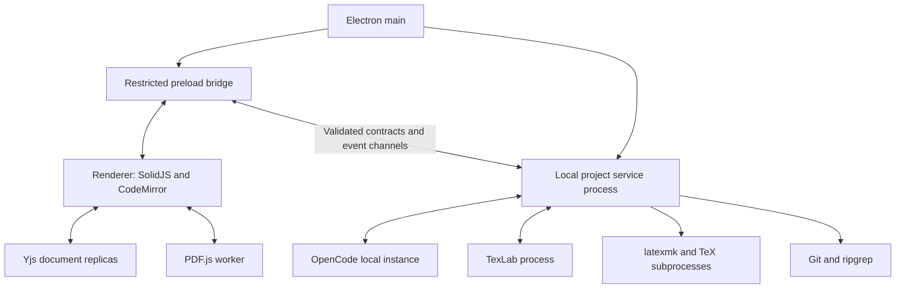

# Loom architecture

**Status:** Planned architecture for the first desktop build; no runtime modules exist yet.

**Product authority:** [PRD.md](PRD.md). **Visual authority:** [DESIGN.md](DESIGN.md). **Build sequence:** [phases.md](phases.md). **Actual implementation state:** [project_status.md](project_status.md).

## 1. System boundaries

Loom supplies a local scientific writing workspace and integrates an external agent harness. It owns manuscript editing, local state, source/PDF navigation, compilation coordination, reference workflows, change review, and Git controls. OpenCode initially owns the model/tool execution loop and its provider configuration. Ordinary project files remain usable outside Loom.

The first validated target is a Linux x86_64 pilot. Process contracts and application services remain portable for later Windows/macOS builds and a future browser client. Accounts, network document synchronization, hosted execution, and live collaboration are outside this build.

## 2. Stack and responsibilities

| Layer | Working choice | Ownership |
|---|---|---|
| Desktop shell | Electron | Windows, lifecycle, native dialogs, protected native entry points |
| Application language | TypeScript | Shared contracts, adapters, application services |
| Development/build | electron-vite | Main, preload, renderer, worker bundles |
| UI | SolidJS | Workspace controls and presentation state |
| Editing | CodeMirror 6 | Editing transactions, selections, decorations, editor integration |
| Live text | Yjs and CodeMirror binding | One logical document state, ready for later network providers |
| PDF | PDF.js and its worker | PDF processing, page rendering, selection and navigation |
| Native services | Node.js in an Electron utility process | Project services, persistence coordination, agent/build/Git subprocess management |
| LaTeX language service | TexLab over LSP | Supported completion, diagnostics and structural navigation |
| Compilation | latexmk and installed TeX engines/BibTeX/Biber | Native project compilation |
| Persistence | IndexedDB and SQLite | Durable Yjs updates; application metadata, manifests, derived indexes |
| Search and VCS | ripgrep and native Git | Filesystem search and repository operations |
| Agent | OpenCode local server and TypeScript SDK | Initial harness integration |
| Packaging | electron-builder | Installable desktop artifact |

Choose and pin actual dependency versions during scaffolding after checking compatibility. This document does not claim that a dependency set has been installed or tested.

## 3. Process model



- **Main:** create/manage windows, initialize service connections, handle native application actions. It does not parse a large manuscript or execute database/indexing loops.
- **Preload:** expose named application capabilities through context isolation. The renderer receives neither unrestricted filesystem APIs nor arbitrary process execution.
- **Renderer:** manage layout, immediate editing, active document views, PDF display, and user-visible state. Keep document text out of unrelated global UI state.
- **Project services:** coordinate project manifests, serialized saves, reconciliation, builds, harness sessions, Git, search, and SQLite access.
- **Workers/subprocesses:** perform expensive PDF processing, parsing/diffs/indexing where needed, native tool execution, and agent execution. Profile before adding more processes; each has startup and memory costs.

Use command/result IPC for bounded operations and message channels for document updates, progress, and agent events. The selected harness may use its own local HTTP transport; that does not require the entire desktop backend to become an HTTP server.

## 4. Module layout

The following is a proposed scaffolding layout, not an inventory of existing files. A single application package is sufficient initially.

```text
src/
  main/                     Electron lifecycle and native integration
  preload/                  Narrow renderer bridge
  renderer/
    workspace/              Shell, panels, tabs, navigation
    editor/                 CodeMirror and document bindings
    pdf/                    Viewer, render cache, source navigation
    agent/                  Conversation, composer, permission/change views
    references/             Bibliography, Zotero, literature UI
    ui/                     Shared primitives and runtime theme tokens
  contracts/                Transport messages, IDs, validation, error types
  domain/                   Project/revision/build/change-set concepts
  services/
    project/                Manifest, paths, file operations
    documents/              Yjs coordination, revisions, reconciliation
    persistence/            SQLite metadata and storage adapters
    builds/                 Tool detection, scheduling, logs, snapshots
    language/               TexLab integration
    agents/                 Common harness contract and OpenCode adapter
    research/               Literature providers, evidence, bibliography, Zotero
    git/                    Native Git operations and document coordination
  workers/                  Measured CPU-heavy operations
tests/
  fixtures/                 Synthetic manuscripts and protocol fixtures
  integration/              Filesystem/native-protocol workflows
  e2e/                      Application acceptance scenarios
```

Renderer imports domain types and contracts, not native service implementations. Domain rules do not depend on Electron or SolidJS. Concrete integrations implement service interfaces. This keeps a future browser transport possible without building a cloud platform now.

## 5. Document model and filesystem bridge

### 5.1 Ownership

While open, a project uses Yjs-backed live text. Renderer and service replicas represent the same logical documents, not competing editable stores. CodeMirror transactions update those documents. Files on disk are synchronized source representations required by compilers, Git, external editors, and harnesses.

Use stable project/file IDs independently of names and absolute paths. A manifest tracks file IDs, relative paths, content types, and revision information. File creation, moves, deletions, and binary replacement are project operations; Yjs text alone does not implement them.

### 5.2 Local edit path

1. Apply a CodeMirror/Yjs transaction immediately so typing does not await I/O.
2. Persist Yjs updates through the local persistence provider and transmit incremental updates to project services.
3. Services apply the updates, advance revision metadata, and schedule a serialized disk save.
4. Write atomically where supported and acknowledge the revision actually persisted to disk.
5. Mark the UI as saved only for acknowledged persistence. If recovery storage and disk differ, display their state honestly.

The logical revision must identify content; timestamps and watcher events alone are insufficient. Track baseline text or hashes and state information needed to reconstruct changes.

### 5.3 External change path

1. A watcher or operation result reports that a project file changed.
2. Compare actual content against the last synchronized baseline and known Loom writes; suppress write/observe feedback loops.
3. Derive a patch against that baseline.
4. If newer live edits exist, reconcile compatible edits or create a conflict record preserving all inputs.
5. Apply resolved changes to Yjs, update editor transactions, persist, and acknowledge the new synchronized baseline.

Re-reading and replacing the entire editor value is not the reconciliation strategy. Handle duplicate/coalesced watcher events, atomic rename saves, deletion, rapid writes, and non-ASCII paths.

### 5.4 Reopen and recovery

On opening a project, load the manifest and recoverable live state, compare with disk, and resolve divergence before writing. After service/renderer failure, resynchronize document replicas and pending acknowledgments before resuming saves. Recovery is independent of Git commits.

Undo, agent change-set revert, and Git history have separate owners. Preserve unrelated newer edits when reverting an agent change; if that cannot be done safely, present the conflict instead of silently restoring a full old file.

## 6. Persistence and data ownership

| Data | Storage/authority | Notes |
|---|---|---|
| Manuscript source and assets | Ordinary project folder | Portable representation used by external tools |
| Live recoverable text | Yjs updates persisted with IndexedDB | Stable local identity and flush/recovery semantics |
| Project manifest, preferences, build/session references | SQLite in application data | Device paths and transient state stay outside source exports |
| Bibliography content | Project `.bib` files | Parsed indexes are derived and rebuildable |
| Agent conversation | Harness session plus Loom presentation references | Choose a documented owner for cached messages; avoid divergent session histories |
| Change baselines/recovery checkpoints | Protected application data | Keep until review/recovery no longer depends on them |
| PDF/log/mapping output | Revision-associated build directory | Bounded cache; retain last successful build as needed |
| Harness/provider credentials | Harness-supported protected storage | Never include in manuscript exports or Git |
| Git history/index/worktree | Native Git | Loom displays and coordinates it |

Persist schema versions and migration state. Define cleanup so it cannot delete required recovery content or active build mappings. Persistent project configuration may be exported deliberately; absolute executables, secrets, private chats, and caches are excluded by default.

## 7. Contracts and operation state

Use stable IDs for projects, files, agent sessions, turns, change sets, builds, and operations. Validate input at process boundaries. Include correlation IDs, project identity, and revision preconditions where mutations depend on existing state.

Application operations use explicit states such as `queued`, `running`, `waiting_for_user`, `succeeded`, `failed`, and `cancelled`. An interrupted process is not a successful operation. UI action availability is derived from capability/operation state, not guessed from a button click.

Document save, agent session, Git operation, and PDF build each have their own state. Their identifiers should make it possible to explain: which source this PDF used, which turn produced this change, and whether a save actually reached disk.

Errors carry a stable category, human-readable explanation, affected project/file/operation, retryability, and technical details suitable for a diagnostic view. Exclude secrets and manuscript content from default logs. Bound event buffers and reject stale results after cancellation or a project switch.

## 8. Agent integration

### 8.1 Adapter contract

The common harness boundary covers:

- Installation/version/configuration detection and connection lifecycle.
- Supported authentication setup and available configured model/capability discovery.
- Session create/load/continue and prompt submission with explicit context/attachments.
- Streamed text, public tool activity, questions, permissions, completion/failure, and cancellation.
- Project binding, interruption recovery, and ownership of launched processes.
- Change tracking/recovery coordination around native filesystem edits.

Normalize capabilities without pretending every harness provides every feature. Use OpenCode's native server/SDK initially. Later adapters may use ACP or another structured native protocol. Terminal UI scraping is not the planned integration method.

### 8.2 OpenCode lifecycle

Prefer a dedicated Loom-owned local instance for a project/session boundary so paths, credentials, permissions, and process ownership are explicit. Attaching to an existing compatible instance is an explicit user action. Use private loopback endpoints with suitable authentication, verify the running version, and distinguish server availability from provider authentication.

Track which processes Loom started. Disconnecting from an externally owned server must not terminate the user's unrelated session. Surface permission requests through the harness; a default working directory is not proof of filesystem isolation.

### 8.3 Edits and tools

Before an editing turn, capture affected project revision/baseline information and a recoverable checkpoint. Observe native agent writes through the document bridge and group changes by turn. Initial semantics are authorized direct edits followed by review/recovery; they are not universally staged before execution.

Expose Loom-specific capabilities through supported tool integration, including MCP where appropriate. Tools may request a scheduled build, inspect diagnostics, query project references, or retrieve literature. Registered compile tools should use Loom's scheduler so output can be associated with its source revision. Arbitrary shell execution remains governed by the harness's actual permissions.

Project context is retrieved through relevant files and tools. The agent can inspect the manuscript's structure and dependencies without sending every file in every request. Preserve provenance and distinguish an explanation from an executed check.

## 9. Builds, language features, and PDF

The toolchain service detects installed `latexmk`, engines, and bibliography tools and records compatible configuration. Guided setup links to suitable installation instructions; the initial app does not bundle a complete managed TeX distribution.

Use one build scheduler per project. Coalesce pending edits, support cancellation and clean rebuilds, and capture a stable source snapshot or identify changed inputs. Do not compete with a second automatic build loop owned by the language integration.

A build record includes source snapshot ID, file/path manifest, root file, engine/recipe/tool versions, diagnostics, timestamps, status, and PDF/mapping locations. Keep snapshot paths mapped to original project paths so SyncTeX can navigate correctly. Record versions without promising a fully reproducible environment.

TexLab receives the document versions needed for language features; native diagnostics and parsed compiler logs remain traceable to files/revisions. A failed build retains the last successful PDF with a stale/failed indication.

PDF.js processes PDFs through its worker. Render visible pages plus a small bounded buffer, cancel obsolete render requests, release distant canvases, and preserve useful reading position. Use the mapping from the displayed build, not an unrelated current build. Report approximate/unavailable source mapping honestly.

## 10. Research and bibliography services

Use provider interfaces for arXiv, Zotero, and local bibliography lookup. Normalize bibliographic identifiers and metadata while preserving original BibTeX fields. Derived indexes can use SQLite full-text search; file content remains authoritative.

Search candidates carry provenance, retrieval state, available evidence level, and direct source links. A record may have metadata/abstract only; the interface must not imply full-text inspection. Citation insertion groups a bibliography update with its source reference and handles duplicate identifiers and key collisions.

Zotero integration initially reads/searches a supported library and imports explicit selections. No general bidirectional library editing is required. Whiteboard conversion and figure/table assistance use supported harness/model capabilities; preserve original assets and allow correction before interpreting results as manuscript content.

## 11. Git and export coordination

Native Git owns repository state and credential use. Loom coordinates operations with live documents:

1. Flush or preserve pending edits and capture a baseline before a mutation that can change working files.
2. Inspect the dirty state and present relevant choices before pull, merge, or branch switching.
3. Serialize incompatible operations with agent editing and saves.
4. Reconcile resulting filesystem changes into the live document model.
5. Surface conflicts and retain the inputs until resolved.

Review/revert controls never imply an automatic commit or remote push. Source exports include required source/assets and optional portable build configuration, excluding private app state. PDF exports identify the build revision and warn when the source has advanced.

## 12. Performance and future expansion

Use the workload and targets in PRD Section 10 as the performance authority. Keep UI stores narrow, documents incremental, PDF/chat/log lists bounded, agent events batched, and optional services lazy. Measure packaged behavior and memory growth during repeated work.

Provide interfaces for document providers, storage, identity, harnesses, literature providers, and local/remote commands where the product needs those seams. Keep Yjs network transport separable from editor bindings. The initial app has no cloud authentication, synchronization server, PostgreSQL deployment, Redis deployment, or hosted workers.

Future cloud architecture is described in PRD Section 9. Introducing it requires explicit authorization, permissions on live connections, durable sync acknowledgment, binary asset handling, and tests of agent/Git/remote-edit concurrency. It is outside [the first-build phases](phases.md).
